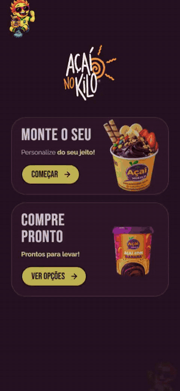
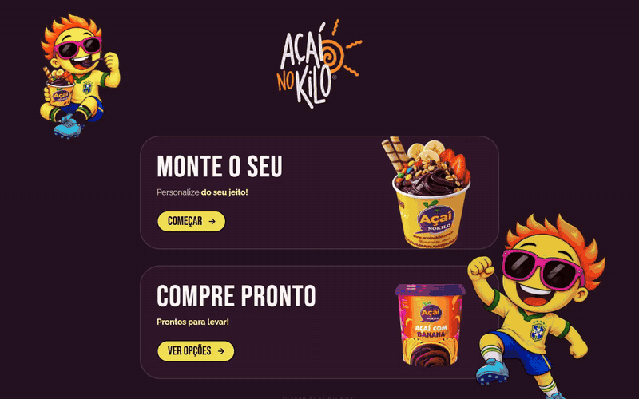
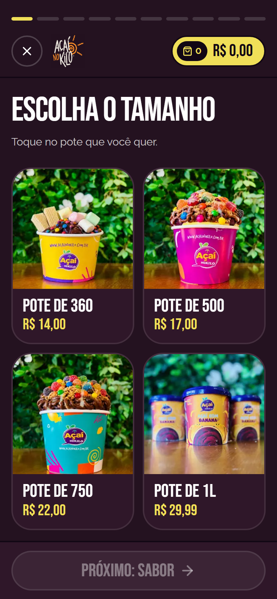
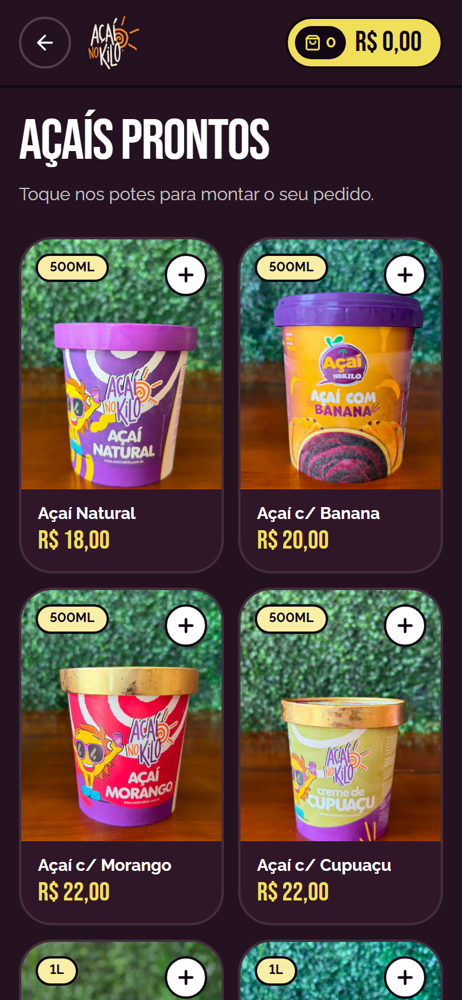
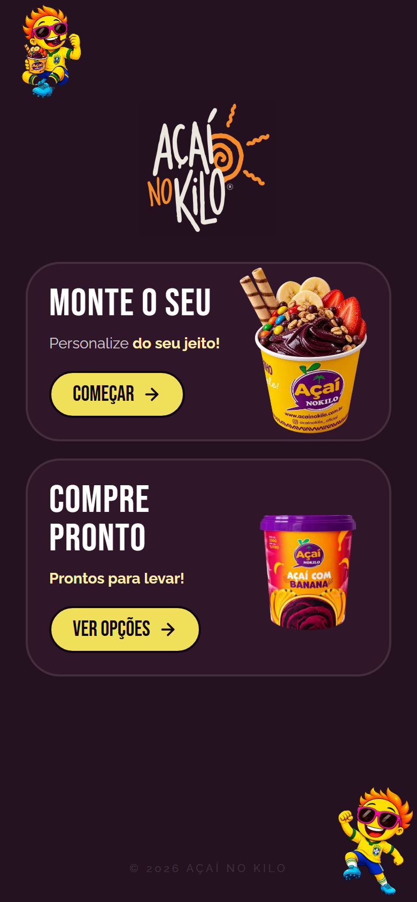

# Açaí no Kilo — Digital Menu & Ordering

> Mobile-first digital menu for a neighborhood açaí shop: customers build their own bowl step by step and send a ready-to-read order straight to the shop's WhatsApp.

  

## Highlights

<!-- XYZ: "Accomplished [X] as measured by [Y], by doing [Z]". Troque/adicione números de negócio que o cliente autorizar. -->

- **Turned a long WhatsApp conversation into one structured message**, covering the full order (size, flavor, every topping, delivery, payment and change), by building a 10-step "build your own" flow that keeps the running total always on screen.
- **Gave the owner full control of the menu with zero developer help**, as measured by prices, availability and new items all editable from the admin panel, by building a JWT-protected admin with daily, weekly and monthly sales reports.
- **Shipped a menu that never blocks an order**, as measured by 170+ automated tests across frontend, Node API and PHP API, by designing an offline fallback where the order still reaches WhatsApp even if the API is down.

## The story (STAR)

### Situation

Orders arrived as long WhatsApp conversations: the customer asked for prices, picked a size, then listed toppings one message at a time while the staff typed the total by hand. With dozens of toppings, creams, fruits and fillings (the shop's main differentiator), orders were slow to take and easy to get wrong.

### Task

Build a digital menu where customers assemble their order alone on their phone, the shop receives it complete and correct, and the owner can keep the menu up to date without a developer, all running on the shop's low-cost shared hosting.

### Action

- **Designed the ordering flow around one thumb:** size → flavor → toppings → extras → creams → fruits → fillings → delivery or pickup → payment → summary. Every screen was checked from 320px up and for steps with 2 to ~26 items with long names, since the menu is editable.
- **Added ready-made products** with a cart, for customers who just want to grab a pot.
- **Made "nothing blocks the order" a rule in code:** saving the order to the database never throws; if the network fails, the menu falls back to local data and the WhatsApp message still goes out.
- **Two backends, one contract:** the shop's hosting (Hostinger) doesn't run Node, so I'm porting the Express API to plain PHP + MySQL route by route. The same contract tests run against both (Node with in-memory MongoDB, PHP with a temporary SQLite database).
- **Offline demo mode** on Vercel with local data and a demo-only admin, so I could present the full product to the owner before paying for production hosting.
- **Security by default:** Helmet, CORS allow-list, rate limits on login (5/min) and orders (10/min) per IP, JWT admin routes, and server-side validation that mirrors the form limits (a test keeps them in sync).
- **Flat 2D visual language** to match the hand-drawn mascot and logo, following a designer's recommendation the owner approved.

### Result

- The shop receives the whole order in one structured WhatsApp message, instead of a back-and-forth chat.
- The owner changes prices and turns off out-of-stock items alone, and follows sales in the admin reports.
- The product was presented and approved through the live demo before any hosting cost.

<!-- Adicione aqui resultados medidos e autorizados pelo cliente, ex.: "X pedidos/mês pelo cardápio", "tempo médio para fechar um pedido caiu de A para B min". -->

## Tech stack

React 19 · TypeScript · Vite · Tailwind CSS · GSAP · Node.js / Express 5 · MongoDB · PHP 8 + MySQL · Vitest · Vercel

## Screenshots

  

| Build your own | Ready-made | Home (mobile) |
| --- | --- | --- |
|  |  |  |

## About this repository

The source code is private due to client confidentiality. This page documents the project, my role and the decisions behind it.
Want something similar for your business? [Get in touch](https://schaidenunes.com/).

**My role:** Full-stack developer, solo project, from requirements and design to deploy
**Duration:** April – October 2026 (~180 commits)
